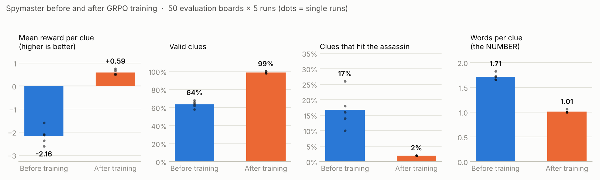
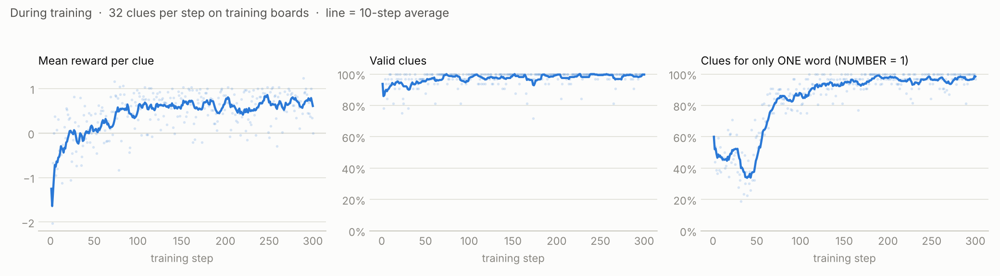

# Codenames Spymaster: Training a Small LLM with Reinforcement Learning

I wanted to learn how large language models (LLMs) work, and how you can make one better at a
specific task. So I picked a fun task: the board game **Codenames**. In this project I train a small
open model (**Qwen2.5-1.5B-Instruct**) to be a better **spymaster**, the player who gives the clues.

The model learns with **reinforcement learning** (GRPO). It plays the game, another LLM tries to
guess, and the score of each turn tells the model what to do more and what to do less.

**Result:** the average score per clue went from **−2.16** to **+0.59**. The trained model breaks
the rules less often and almost never hits the assassin anymore. But it also found a "safe" strategy
I did not want: it now almost always gives clues for only **one** word. More about that below.



---

## Contents

- [The game](#the-game)
- [The setup](#the-setup)
- [The process](#the-process)
- [Results](#results)
- [What the model learned, and what it did not](#what-the-model-learned-and-what-it-did-not)
- [Lessons learned](#lessons-learned)
- [Next steps](#next-steps)
- [Run it yourself](#run-it-yourself)
- [Project structure](#project-structure)

---

## The game

Codenames is played with 25 words on a board. In this project every board has:

| Type | Count | What happens if the guesser picks it |
|---|---|---|
| Team words | 9 | Good. The guesser may continue. |
| Opponent words | 8 | Bad. The turn ends. |
| Neutral words | 7 | A bit bad. The turn ends. |
| Assassin | 1 | Very bad. The turn ends. |

The **spymaster** sees all the roles. They give a **one-word clue** and a **number**, for example
`ocean, 2`. The number says how many team words the clue is about. The **guesser** only sees the
words and tries to find the team words.

The difficult (and interesting) part is **combining words**: one clue that points to several of
your words, but not to the dangerous ones.

In this project one episode is **one turn**: board → clue → guesses → score.

### The reward

Each clue gets a score (the *reward*). The model tries to make this number as high as possible.

| Outcome | Reward |
|---|---|
| Each correct team word | +1 |
| Neutral word | −0.5 (turn ends) |
| Opponent word | −1 (turn ends) |
| Assassin | −5 (turn ends) |
| No team word guessed at all | −1 extra |
| Illegal clue or wrong format | −3 |

A clue is **illegal** if it is a word on the board, part of a board word (`bankrupt` with `bank`),
a form of a board word (`sharks` with `shark`), not one single word, or a copy of the example
clue in the prompt.

---

## The setup

| Part | Choice | Why |
|---|---|---|
| Spymaster (trained) | Qwen2.5-1.5B-Instruct | Small enough to train for free on a Colab T4 GPU |
| Guesser (fixed) | Llama 3.3 70B Instruct Turbo, via the Inworld API | Strong, cheap, no "thinking" mode, different model family than Qwen |
| Local runs | Ollama (4-bit model) | Run the evaluation on a normal laptop |
| Training | Hugging Face TRL `GRPOTrainer` + LoRA (PEFT) | Standard tools for RL on LLMs |
| Word list | 412 English nouns of 5+ letters | Self-made list, no very short words |

**Fair comparison.** The evaluation always uses:
- the same **50 evaluation boards** (fixed seeds, never used in training);
- the same prompts, rules and reward;
- the same guesser at temperature 0;
- **5 runs** per model, to see how much the score changes only by chance.

---

## The process

### 1. Build the game

First I built the game in Python: board generation, the rules, the prompts, a parser for the model
output, and the reward function. Everything has unit tests (`pytest`).

The players use any OpenAI-compatible API. So the same code works with a local model in Ollama and
with an online model.

### 2. First baseline, and what went wrong

My first baseline used the same small Qwen model as both spymaster and guesser. The results were
bad, but they taught me a lot:

- **The model copied the prompt.** The prompt said `CLUE: <word>`, and the model wrote
  `CLUE: <rabbit>` with the angle brackets. Later the prompt had an example clue (`ocean`), and the
  model just used `ocean` as its clue again and again.
- **The model repeated its own words.** Many clues were simply one of the team words on the board.
- **The guesser was too weak.** For 44% of the valid clues, the small guesser did not pick any word.
  A good clue cannot get a good score if the guesser does not understand it.

Score of this first attempt: mean reward **−2.39**, only **29%** valid clues.

### 3. Fix the setup

- **Better prompt:** no placeholders, clear rules, and one worked example as an earlier chat turn.
- **The example clue is illegal** in real games, so copying it does not pay off.
- **−1 for a useless clue:** before this change, a legal clue that found nothing gave 0 points. That
  was a "safe" choice, better than trying and failing.
- **A strong, fixed guesser:** Llama 3.3 70B via an API. It is cheap and it does not change during
  the project.
- **Save the raw guesser answer** for every board, to debug problems.

### 4. Final baseline

With the fixed setup I measured the untrained model again: 5 runs × 50 boards.
Mean reward **−2.16** (runs between −2.61 and −1.60). Only 64% of the clues were valid, and 17% of
the clues led the guesser to the assassin.

The most common mistake now: the model **still copied the example clue** (`fins`) in 71 of the 250
turns. It also used `fin` a lot: almost a copy, but just different enough to be legal.

### 5. Training with GRPO (Google Colab)

GRPO (*Group Relative Policy Optimization*) works like this:

1. The model gets a board and writes **8 different clues** for it (sampling with temperature 1.0).
2. Every clue is played: the guesser guesses, and the reward function gives a score.
3. Each clue is compared with the **average of its group of 8**.
4. The model weights are updated: tokens of clues that were better than average become more likely,
   tokens of worse clues become less likely.

The model is never told *why* a clue is good. It only sees which clues get more points.

**LoRA:** training all 1.5 billion weights does not fit on a free GPU. With LoRA the original weights
stay frozen, and only small extra matrices in each layer are trained (r = 16). The result is a small
adapter file.

Training settings:

| Setting | Value |
|---|---|
| Training boards | 3,000 (seeds 0–2,999; evaluation boards start at 1,000,000) |
| Steps | 300 (each step: 4 boards × 8 clues = 32 clues) |
| Learning rate | 1e-5 |
| LoRA | r = 16, alpha = 32, all attention and MLP projections |
| KL penalty (beta) | 0.04 |
| Max clue length | 32 tokens |
| GPU | Colab T4 (free), float16 |

Some practical details:
- The guesser answers are **cached**. When the model gives the same clue twice for the same board,
  there is no second API call.
- Checkpoints are saved to Google Drive every 25 steps, so training can continue after a disconnect.
- Every sample (clue, guesses, reward) is written to a log file, to check for reward hacking.

### What happened during training



The log of all 9,600 training clues (`training_results/grpo-v1/reward_log.jsonl`) shows three phases:

1. **Steps 1–25: learn the rules.** The model stops copying the example clue (`fins`/`fin` 18 times
   in the first 25 steps, 0 times after that). Mean reward: −0.35.
2. **Steps 25–50: try to combine.** For a short time the model gives *more* clues for 2 or 3 words
   (only 35–40% of the clues are for one word).
3. **Steps 50–150: play safe.** The share of one-word clues goes from about 50% to 95%. At the same
   time the reward goes up to about +0.6, and then it stays flat.

So the reward did not go up because the model got better at combining words. It went up because the
model *stopped* combining words. (These numbers are on training boards with sampling temperature 1.0,
so they are not the same as the evaluation numbers below.)

### 6. Export and evaluate

After training, the LoRA adapter is merged into the base model and exported to **GGUF Q4_K_M**.
This is the same 4-bit format as `qwen2.5:1.5b` in Ollama, so the comparison stays fair. Then the
trained model runs the exact same evaluation as the baseline.

---

## Results

| Metric | Before training | After training |
|---|---|---|
| **Mean reward per clue** | **−2.16** (runs: −2.61 to −1.60) | **+0.59** (runs: +0.50 to +0.75) |
| Valid clues | 64% | 99% |
| Words per clue (the NUMBER) | 1.71 | 1.01 |
| Correct guesses per valid clue | 0.54 | 0.90 |
| All words of the clue guessed | 16% | 88% |
| Hit the assassin | 17% | 2% |
| Hit an opponent word | 15% | 4% |
| Hit a neutral word | 13% | 3% |

The worst run after training (+0.50) is much better than the best run before training (−1.60).
So the improvement is not luck.

### Examples (same boards, before and after)

| Board | Before | After |
|---|---|---|
| assassin: *sword* | `weapons, 1` → sword: **assassin** (−6) | `dock, 1` → harbor (+1) |
| assassin: *desert* | `dunes, 2` → desert: **assassin** (−6) | `bottom, 1` → floor (+1) |
| team: *shark*, … | `fins, 2` → illegal, copied the example (−3) | `tooth, 1` → shark (+1) |
| team: *geyser*, … | `a, 1` → illegal, not a word (−3) | `erupts, 1` → geyser (+1) |
| team: *trumpet, piano, elephant*, … | `musical, 3` → trumpet, piano, then crane: neutral (+1.5) | `tusks, 1` → elephant (+1) |
| assassin: *compass* | `arms, 1` → ladder (+1) | `direction, 1` → compass: **assassin** (−6) |

The `musical, 3` clue is interesting: the untrained model *tried* to combine three words, and two
were correct. The trained model plays safe with `tusks, 1`. The trained model is not perfect: `direction` still points to the assassin `compass`.

---

## What the model learned, and what it did not

**It learned:**
- to follow the rules (illegal clues went from 36% to 1%);
- to stop copying the example;
- to avoid the assassin and the opponent words.

**It did not learn to combine words.** In 245 of the 247 valid clues the number is **1**. The model
found out that a clue for one word is almost always guessed correctly (+1). A clue for 2 or 3 words
*can* give +2 or +3, but it also has a real chance of −2 or −6. On average, "always 1" won.

This is not a bug in the training. It is **exactly what reinforcement learning does**: the model
finds the best strategy for the reward I gave it. My reward did not make combining words worth the
risk. This is a small, clear example of a big topic in AI: *you get what you measure, not what you
mean*.

---

## Lessons learned

1. **Measure first.** Without a fixed baseline (same boards, same guesser, several runs) I could
   not say if training helped.
2. **Small models copy.** Placeholders and examples in the prompt end up in the output. Make the
   example clue illegal, or the model learns to copy it.
3. **The judge sets the ceiling.** A weak guesser makes good clues look bad. The model can never
   become better than the guesser that scores it.
4. **The reward is the real instruction.** The model optimized my reward, not my goal. Every
   "safe" option in the reward (0 points for nothing, +1 for an easy clue) becomes a strategy.
5. **Training loss means little in GRPO.** It stays close to 0. The reward curve and the actual
   samples are what you need to look at.
6. **Small details break training on free GPUs.** A T4 does not support bfloat16, even when
   PyTorch says it does. Old packages in Colab can also block imports.

---

## Next steps

- **Reward combining words more:** for example +1 for one correct word, +3 for two, +6 for three.
  Or a small penalty for clues with number 1. Then train again (`RUN_NAME = "grpo-v2"`) and measure
  the baseline again with the new reward.
- **Test with humans:** play as the guesser (`--guesser human`) to see if the clues work for people,
  not only for Llama.
- **Use more than one guesser model**, so the spymaster does not learn the habits of one model.
- **Multi-turn games:** now one episode is one turn. A full game would also teach planning.

---

## Run it yourself

### Requirements

- Python 3.10+
- [Ollama](https://ollama.com) for local evaluation
- An API key for the guesser (this project uses [Inworld](https://inworld.ai); OpenRouter and OpenAI
  also work)
- A Google account for training in Colab (free T4 GPU)

### Install

```bash
python -m venv .venv
.venv\Scripts\activate            # Windows  (Linux/macOS: source .venv/bin/activate)
pip install -r requirements.txt
pytest
```

Copy `.env.example` to `.env` and add your key:

```
INWORLD_API_KEY=your-key-here
```

`.env` is in `.gitignore`, so the key is never committed.

### 1. Baseline

```bash
ollama pull qwen2.5:1.5b
python baseline.py --model qwen2.5:1.5b --guesser-provider inworld --guesser-model deepinfra/meta-llama/Llama-3.3-70B-Instruct-Turbo --runs 5
```

Test with `--runs 1 --n 2` first. Other options:

```bash
# you are the guesser, the LLM is the spymaster
python baseline.py --model qwen2.5:1.5b --guesser human --n 5 --runs 1
# you are the spymaster, random guesser (no LLM needed)
python baseline.py --spymaster human --guesser random --n 3 --runs 1
```

Results are saved in `eval_results/<spymaster>__vs__<guesser>/`:

| File | Content |
|---|---|
| `runs.csv` | metrics per run |
| `summary.json` | mean, std, min and max over all runs |
| `run_k.jsonl` | every board: roles, raw model output, clue, guesses, outcome, reward |

### 2. Training

Open [`train_grpo.ipynb` in Colab](https://colab.research.google.com/github/casruger/code-names-trained-llm/blob/main/train_grpo.ipynb),
choose a **T4 GPU**, add `INWORLD_API_KEY` in Colab Secrets, and click *Run all*.
The notebook trains the model, measures it before and after, and saves the adapter and a GGUF file
to Google Drive.

### 3. Evaluate the trained model

Put `codenames-spymaster-q4_k_m.gguf` in a folder `trained_model/`, then in PowerShell:

```powershell
cd trained_model
ollama show qwen2.5:1.5b --modelfile > Modelfile
(Get-Content Modelfile) -replace '^FROM .*', 'FROM ./codenames-spymaster-q4_k_m.gguf' | Set-Content Modelfile
ollama create codenames-spymaster -f Modelfile
cd ..
python baseline.py --model codenames-spymaster --guesser-provider inworld --guesser-model deepinfra/meta-llama/Llama-3.3-70B-Instruct-Turbo --runs 5
python compare.py eval_results/qwen2.5_1.5b__vs__deepinfra_meta-llama_Llama-3.3-70B-Instruct-Turbo eval_results/codenames-spymaster__vs__deepinfra_meta-llama_Llama-3.3-70B-Instruct-Turbo
```

The model file (`codenames-spymaster-q4_k_m.gguf`, 986 MB) is not in this repository: GitHub allows
at most 100 MB per file. `trained_model/Modelfile` is included.

---

## Project structure

```
codenames/
  words.py      word list (412 English nouns, 5+ letters)
  board.py      board generation; EVAL_SEED keeps evaluation boards apart from training boards
  rules.py      is a clue legal?
  prompts.py    prompts for spymaster and guesser (same in evaluation and training)
  parsing.py    model text -> clue / guesses
  reward.py     the reward function
  game.py       score_clue_text(): one turn, from raw model output to reward
  players.py    LLM players (Ollama, Inworld, OpenRouter, OpenAI), human and random players
  metrics.py    summary statistics per run
  training.py   dataset, reward function with cache, and evaluation for GRPO
baseline.py     evaluate a spymaster on the 50 evaluation boards (several runs)
compare.py      compare two evaluations, make docs/results.png
plot_training.py  training curves from the reward log, make docs/training.png
training_results/ reward log of the training run (every clue, guesses and reward)
trained_model/  Modelfile to load the trained model in Ollama (the .gguf file is not in git)
train_grpo.ipynb  training in Google Colab
tests/          unit tests
eval_results/   evaluation results (archive/ = first attempt with the small guesser and old prompt)
```

## License

MIT. See [LICENSE](LICENSE).
